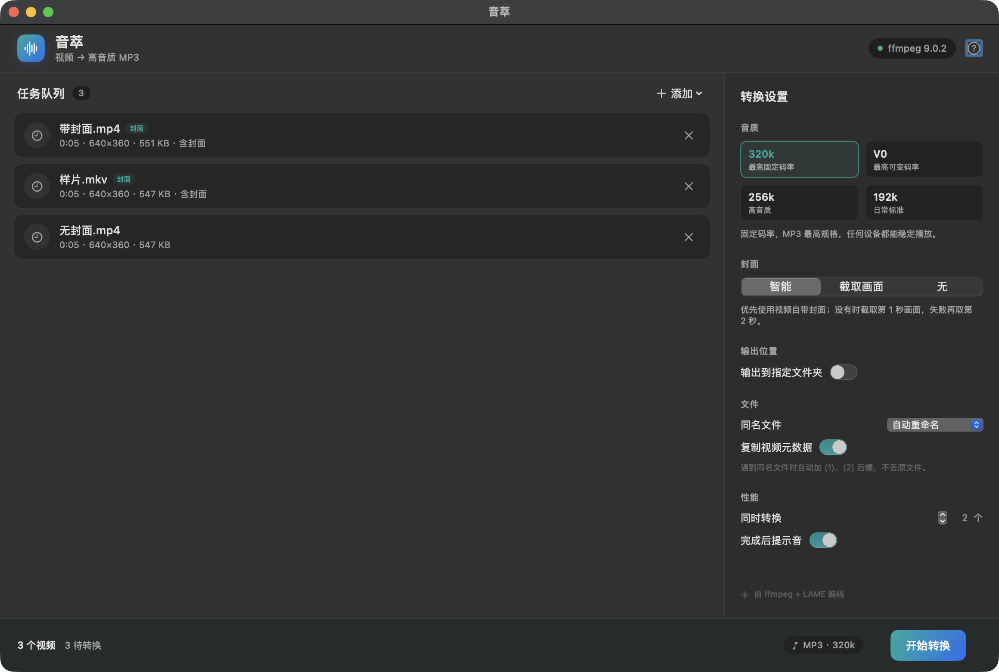
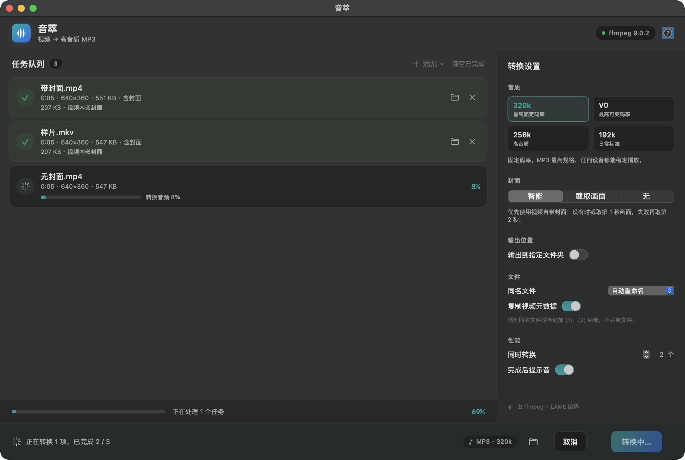
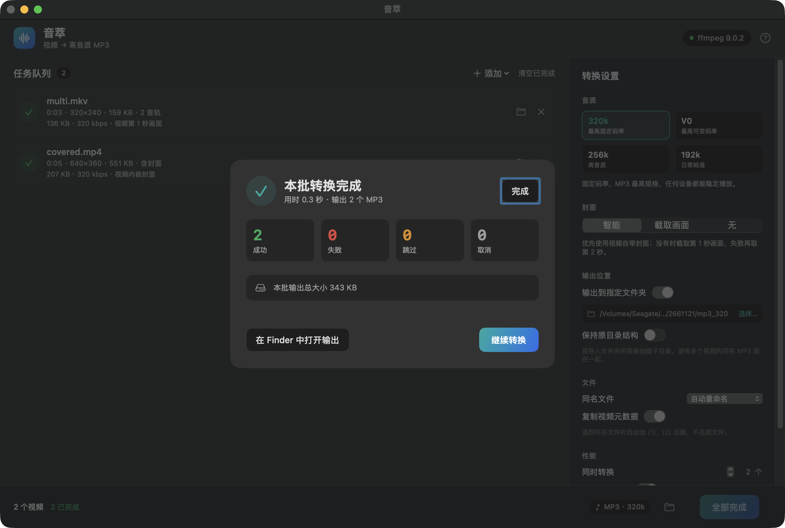

# 音萃 · SoundDistill

一个原生 macOS 视频转 MP3 工具：从 **MP4 / MKV / MOV** 等视频中提取音轨，输出高音质 MP3，并自动把视频封面写入音频文件。

[GitHub](https://github.com/charsen/sound-distill) · [Gitee](https://gitee.com/charsen/sound-distill) · MIT License



批量转换进行中：



批次完成汇总：



## 功能

- **高音质音频提取**
  - 默认 **320 kbps CBR**（MP3 格式的最高码率），也可选 **VBR V0**、256 kbps、192 kbps。
  - 使用 LAME 最高质量编码策略（`compression_level 0`），保留原始采样率（最高 48 kHz）。
  - 低采样率素材自动按 MP3 合法码率上限编码，并在界面/CLI 明确提示（例如 22.05 kHz 最高 160 kbps）。
  - 支持选择视频中的指定音轨；未选择时自动使用容器默认音轨。
  - 5.1 等环绕声音轨自动下混为立体声，保证 MP3 兼容性。
- **智能封面**
  - 优先使用视频内嵌封面（MP4 的 `covr`、MKV 的 attached picture / 图片附件）。
  - 没有内嵌封面时，截取视频第 **1 秒**画面；失败再取第 **2 秒**，极短视频退回第 **0 秒**。
  - 以 ID3v2.3 APIC 写入 MP3，macOS「音乐」、Finder、第三方播放器都能读取。
- **批量处理**
  - 拖入多个文件或整个文件夹，自动递归扫描。
  - 可调并发数（1–8，默认 2），逐项进度、随时取消、失败可重试。
  - 未完成任务自动持久化，App 重启后可恢复队列；每批结束显示成功/失败/跳过/取消汇总。
- **贴心的输出规则**
  - 默认输出到视频同目录；也可指定统一的输出文件夹。
  - 同名文件默认自动加 `(1)`、`(2)` 后缀，不覆盖原文件；也支持覆盖或跳过。
  - 自定义输出目录时可保持导入文件夹的目录结构。
  - 自动复制视频中的标题、艺术家、专辑、日期、流派、注释等元数据。
- **开箱即用**：发布包内置 ffmpeg/ffprobe，用户机器无需安装 Homebrew；也支持从 Finder 右键「打开方式」或拖到 Dock 图标批量导入。

## 系统要求

- 源码与 Swift 二进制支持 macOS 14.0 或更高版本；当前附带内置 ffmpeg 的 DMG 见下方最低系统说明。
- 当前构建为 **Apple Silicon（arm64）**。如需 Intel 版本，请在本机用 x86_64 的 ffmpeg 重新执行打包脚本。
- 构建脚本会读取内置 ffmpeg 的 `LC_BUILD_VERSION/minos` 并同步提升 `LSMinimumSystemVersion`；本机 Homebrew ffmpeg 的 minOS 为 **27.0**，因此当前 DMG 实际要求 **macOS 27+**。若要在更旧系统运行，请用 `BUNDLE_FFMPEG=0` 并配合目标系统可用的 ffmpeg 构建。
- 本地构建使用 ad-hoc 签名，未做 Apple 公证；首次打开如被系统拦截，请右键「打开」或在「系统设置 → 隐私与安全性」中允许。

## 构建

需要 Xcode 16+（Swift 6）和 Homebrew 的 ffmpeg：

```bash
brew install ffmpeg
Scripts/build_app.sh release
```

产物：`build/音萃 SoundDistill.app`（内置 ffmpeg，约 40 MB）。

如需生成 DMG：

```bash
Scripts/package_dmg.sh
# build/音萃 SoundDistill-1.0.1.dmg
```

构建选项：

- `BUNDLE_FFMPEG=0 Scripts/build_app.sh`：跳过内置 ffmpeg，运行时使用系统安装的 ffmpeg。
- `Scripts/build_app.sh debug`：构建 Debug 版本。
- `Scripts/make_icon.py`：重新生成应用图标（需要 Pillow）。

> 内置的 ffmpeg 来自 Homebrew 构建（`--enable-gpl`）。如果对外分发，请遵守 FFmpeg 的 GPL/LGPL 许可要求并附带相应许可证。

## 使用

1. 打开「音萃 SoundDistill」。
2. 把视频文件或文件夹拖进窗口，或点「选择视频…」/「选择文件夹…」。
3. 在右侧选择音质、封面策略、输出位置等。
4. 点「开始转换」（或 ⌘↩）。
5. 完成后点行尾的文件夹图标，在 Finder 中查看生成的 MP3。

快捷键：

| 快捷键 | 功能 |
| --- | --- |
| ⌘O | 添加视频 |
| ⇧⌘O | 添加文件夹 |
| ⌘↩ | 开始转换 |
| ⌘. | 取消全部 |

## 命令行工具

构建时会同时生成 `build/sounddistill`：

```bash
build/sounddistill probe 视频.mp4
build/sounddistill convert 视频1.mp4 视频2.mkv -o ~/Music/输出 --quality 320 --jobs 2
build/sounddistill convert ~/Videos/素材库 -o ~/Music/输出 --cover smart
build/sounddistill convert 电影.mkv -o ~/Music/输出 --audio-index 2
```

参数：

- `--quality 320|v0|256|192`：音质档位，默认 320。
- `--cover smart|frame|none`：封面策略，默认 smart。
- `--conflict rename|overwrite|skip`：同名文件处理，默认 rename。
- `--audio-index <n>`：选择音轨（先用 `probe --json` 查看 stream index）。
- `--no-metadata`：不复制视频元数据。
- `--jobs 1-8`：并发数，默认 2。
- `--json`：以 JSON 输出结果。

## 开发

```bash
swift build            # 构建全部 target
swift test             # 26 个测试（含真实 ffmpeg 端到端测试）
swift run sounddistill --help
```

若 Xcode 图形界面正常但命令行报 `xcrun: unable to lookup item 'SDKVersion'`，先执行：

```bash
export DEVELOPER_DIR=/Applications/Xcode.app/Contents/Developer
```

项目结构：

```
Sources/
  SoundDistillCore/     # 探测、封面识别、命令构建、转换服务（可独立测试）
  SoundDistillApp/      # SwiftUI 界面
  SoundDistillCLI/      # 命令行工具
Tests/
  SoundDistillCoreTests/
Scripts/
  build_app.sh          # 构建 .app + 内置 ffmpeg
  bundle_ffmpeg.sh      # 递归打包 Homebrew dylib 并改写 load path
  package_dmg.sh        # 打包 DMG
  make_icon.py          # 生成 AppIcon.icns
Resources/
  Info.plist
  AppIcon.icns
```

### 音质说明

MP3 本身是有损格式，320 kbps CBR 是它的最高规格。转码过程中不会额外提升源音频不存在的细节；如果源视频音轨本身码率很低，输出文件会保持 320 kbps 的容器规格但无法恢复原始损失。对收藏用途优先选 320 kbps 或 VBR V0。

### 已知限制

- 多音轨视频支持选择音轨；未选择时自动使用容器默认音轨。
- 极少数封装格式的封面不是标准图片附件，无法识别时会退化为截取视频画面。
- MP3 不支持多声道环绕声，5.1 音轨会被下混为立体声。

## 许可

本项目代码采用 MIT License。内置的 ffmpeg/ffprobe 由其原始许可证约束（Homebrew 构建为 GPL 版本），分发时请同时遵守 FFmpeg 的许可要求。
